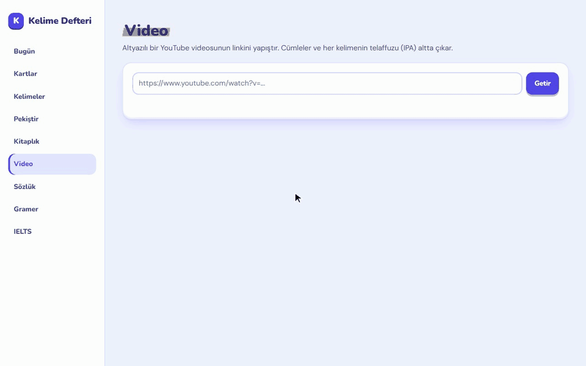
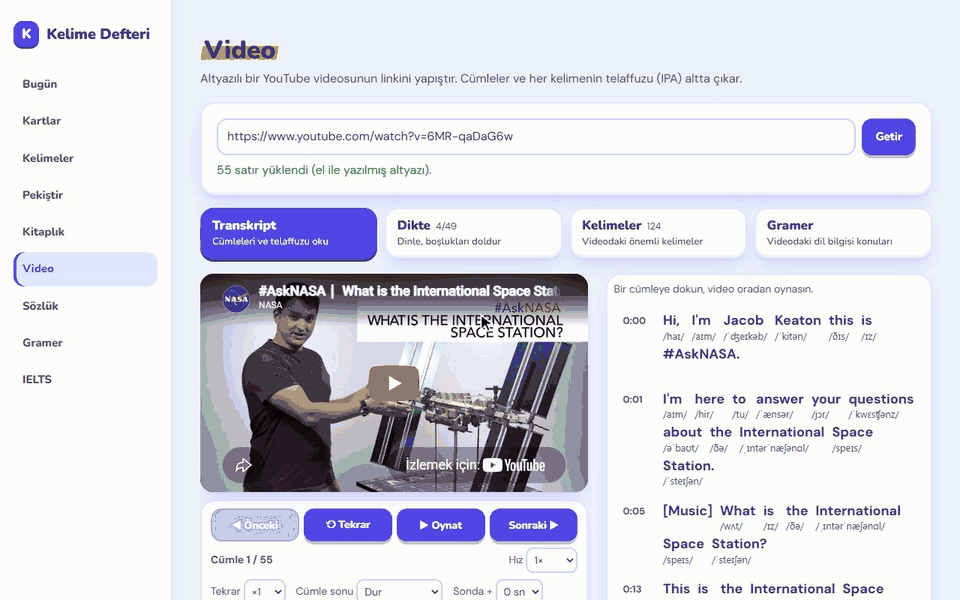
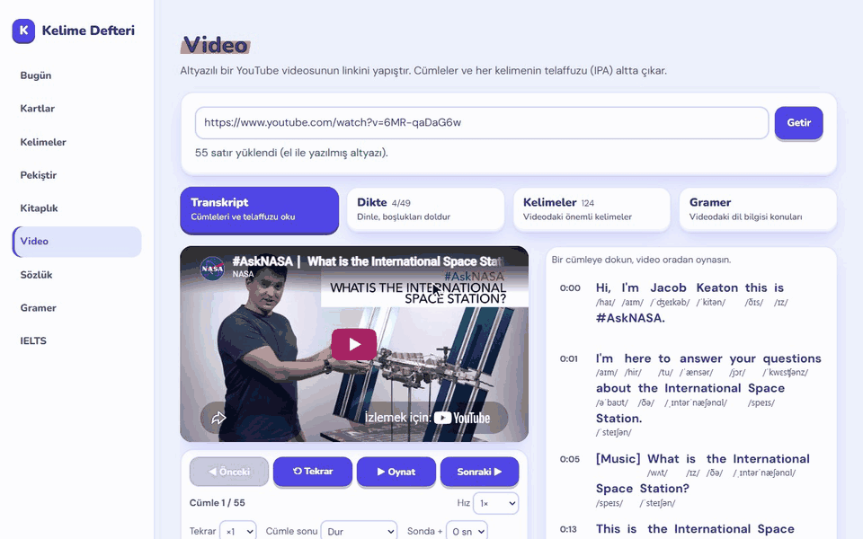
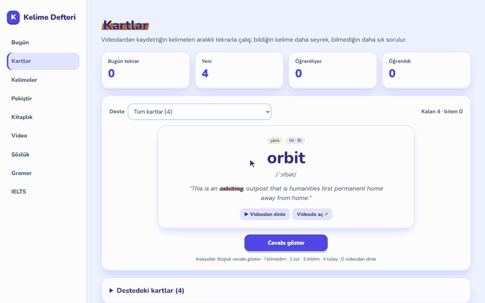
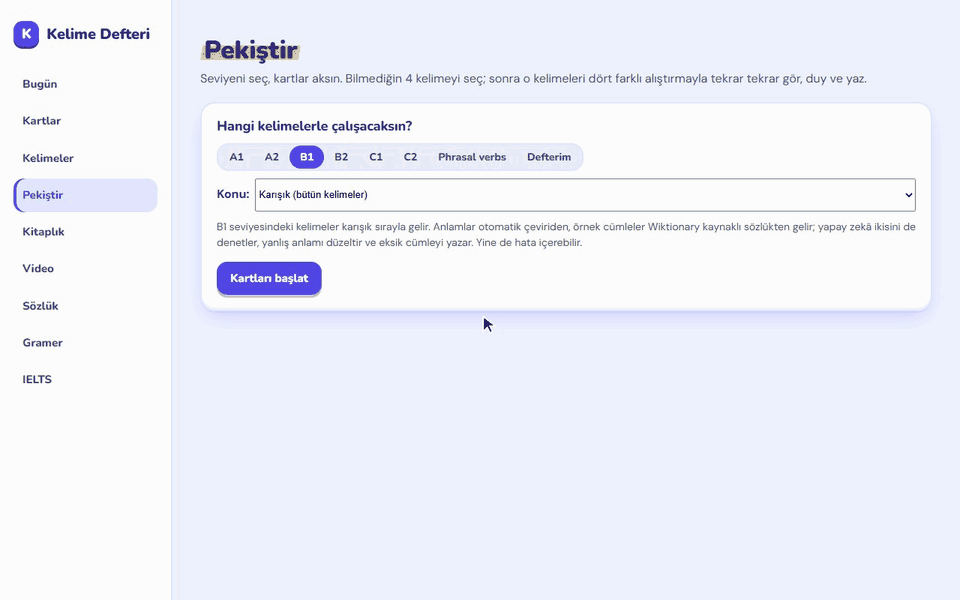
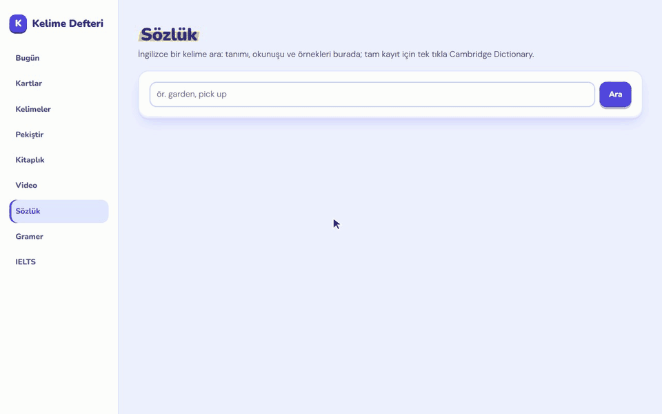
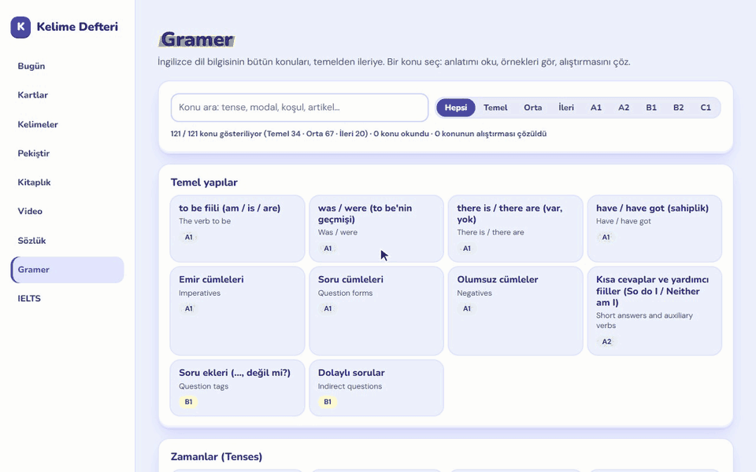

# Kelime Defteri

İngilizce öğrenen Türkçe konuşanlar için bir çalışma uygulaması. Bir YouTube linki verirsin, uygulama transkripti çeker.
Transkript cümlelere bölünür, kelimelerin telaffuzu (IPA) eklenir, kelimeler CEFR seviyelerine (A1–C2) ayrılır ve Türkçe anlamları gelir.
Aynı video üzerinden shadowing, dikte, kelime kartları ve gramer çalışabilirsin.
Bunların yanında aralıklı tekrar destesi, 4 aşamalı kelime pekiştirme, sözlük, 121 konuluk gramer anlatımı ve IELTS çalışma alanları da var.

> **Neden canlı demo linki yok?** Uygulama Google Translate'in resmi olmayan uç noktasını, Gemini API'yi, YouTube transkriptlerini
> ve Free Dictionary API'yi kullanıyor. Hepsinin istek sınırı var; YouTube bulut sunucularının IP'lerini de çoğu zaman engelliyor.
> Herkese açık bir demo bu sınırları birkaç ziyaretçide doldururdu. Bu yüzden aşağıda her bölümün nasıl çalıştığını
> gösteren kısa kayıtlar var; uygulamayı kendin denemek istersen [yerelde çalıştırmak](#kurulum) iki komut.

## İçindekiler

- [Video: transkript, telaffuz, çeviri](#video-transkript-telaffuz-çeviri)
- [Dikte](#dikte)
- [Videodaki kelimeler](#videodaki-kelimeler)
- [Şarkılar](#şarkılar)
- [Kartlar: aralıklı tekrar](#kartlar-aralıklı-tekrar)
- [Pekiştir](#pekiştir)
- [Sözlük](#sözlük)
- [Gramer](#gramer)
- [IELTS ve diğer sayfalar](#ielts-ve-diğer-sayfalar)
- [Nasıl çalışıyor?](#nasıl-çalışıyor)
- [Kurulum](#kurulum)
- [Vercel'de yayınlama](#vercelde-yayınlama)
- [Klasör yapısı](#klasör-yapısı)
- [Dış servisler ve sınırlar](#dış-servisler-ve-sınırlar)

---

## Video: transkript, telaffuz, çeviri



1. YouTube linkini yapıştır. Sunucu İngilizce altyazıyı çeker (elle yazılmış altyazı varsa onu, yoksa otomatik olanı).
2. Altyazı parçaları noktalamaya göre cümlelere birleştirilir ve her kelimenin altına IPA okunuşu yazılır.
3. Oynatıcı ile transkript senkron ilerler, çalan cümle vurgulanır. Bir cümleye dokununca video o cümleye gider.
4. **Shadowing çubuğu:** cümleyi 1–10 kez tekrarlatır. Cümle sonunda durabilir ya da cümlenin süresi kadar bekleyip devam edebilir. Hız 0.5–1.5× arasında ayarlanır.
5. **Cümle kartı:** çalışılan cümle büyük yazılır. "Çevir" Türkçesini getirir, "Kendini kaydet" mikrofonla kaydedip dinletir (kayıt tarayıcıdan çıkmaz), "Sondan başa" cümleyi sondan başa doğru parça parça kurdurur.

## Dikte



- Cümle çalar, video cümlenin sonunda kendiliğinden durur. Seviyeli kelimeler boşluk olur, yazarak ya da kelime çiplerini sürükleyerek doldurursun.
- Üç tür var: **Boşluk**, **Sırala** (karışık kelimeleri sıraya koy) ve **Cümle** (tamamını yaz; eksik kelimeler işaretlenir).
- Zorluk, hangi kelimelerin boşluk olacağını belirler: kolay = B1–C2, orta = temel kelimeler dışındakilerin hepsi, zor = her kelime.
- Sağdaki transkript noktalı görünür (cevap oradan okunmasın); bitirdiğin cümle açılır ve ✓ alır.
- Her cümlenin yalnızca ilk kontrolü puana sayılır. İlerleme video başına saklanır.

## Videodaki kelimeler



- Kelimeler yalın hâllerine indirilir (lemminflect), CEFR seviyesi `cefrpy` ile bulunur, Türkçe anlam çeviriden gelir.
- Çok yaygın kelimeler ("the", "have", "good"…) ayrı bir **Temel** grubuna gider. Temelleri oturmuş bir öğrenci için asıl kıymetli olan biraz daha seyrek kelimeler.
- **Phrasal verbs** ayrı listelenir; "pick it up" gibi araya kelime giren kullanımlar da yakalanır.
- Karta dokununca video kelimenin geçtiği yere gider. "＋ Defter" kelimeyi kaydeder, "＋ Kart" tekrar destesine de ekler. Kaydedilen kelime, geçtiği cümleyi ve o cümlenin saniyelerini de saklar.

## Şarkılar

Video sayfasındaki aynı kutuya bir **Spotify şarkı linki** yapıştırabilirsin. Şarkının zaman damgalı sözleri [LRCLIB](https://lrclib.net)'den gelir ve bir video transkripti gibi işlenir: her satırın altında okunuş, seviyeli kelime listesi, Türkçe anlamlar, dikte ve gramer modu. Şarkı sayfadaki Spotify oynatıcısından çalar; çaldıkça satırlar ilerler, bir satıra dokununca şarkı oradan devam eder.

- Spotify şarkı adını verir ama sanatçıyı vermez, bu yüzden birden çok söz bulunursa kısa bir listeden doğrusunu seçersin. Yanlış sözü sonradan "Başka söz seç" ile değiştirebilirsin.
- Tarayıcıda Spotify'a giriş yapmadıysan oynatıcı yalnızca 30 saniyelik önizleme çalar. Bu durumda satır takibi kapanır; sözler, kelimeler, çeviri, gramer ve dikte metni yine çalışır.
- Şarkıdan kaydettiğin kelimenin kartında "Şarkıda aç" bağlantısı olur, Kitaplık ve Bugün'de başlığın önüne ♪ gelir.
- Sözlerin telifi yayıncılara aittir: sözler yalnızca uygulamanın kendi önbelleğinde (yerelde `cache/`, Vercel'de Redis) tutulur, depoya girmez.

## Kartlar: aralıklı tekrar



- Leitner kutuları: 0, 1, 3, 7, 14 ve 30 günlük aralıklar. "Bilmedim" kartı aynı oturumda yeniden sorar, "Kolay" iki kutu ileri atar.
- Kartta kelimenin videoda geçtiği cümle durur. "Videodan dinle" o cümleyi YouTube'dan çalar.
- Bugün sayfası bekleyen kartları, çalışma serisini ve günün kelimesini gösterir.
- Kısayollar: Boşluk (cevap), 1–4 (puan), D (videodan dinle).

## Pekiştir



Amaç, yeni bir kelimeyle kısa sürede çok kez karşılaşmak.

1. Seviye seç (A1–C2, Phrasal verbs ya da kendi defterin). B1–C1'de istersen bir konu da seçebilirsin (31 konu: iş, sağlık, suç ve hukuk…).
2. Kartlar akar: "Biliyorum" ya da "Bilmiyorum". Bilmediğin 4 kelime toplanınca çalışma başlar.
3. Dört aşama var: **Anlam** (İngilizce ↔ Türkçe), **Telaffuz** (duyduğun kelimeyi seç), **Yazım** (karışık harfleri diz) ve **Cümle** (örnek cümledeki boşluğu doldur). Yanlış yaptığın soru, doğru cevaplayana kadar aşamanın sonuna eklenir.
4. Biten 4 kelime kendiliğinden kartlara eklenir; tekrarı Kartlar sayfasında sürer.

Kelime haznesi sunucuda birikir. Anlam ve örnek cümle çeviri ile sözlükten gelir, Gemini bunları yalnızca denetler: yanlış anlamı düzeltir, uygunsuz örneği değiştirir.

## Sözlük



- Tanım, IPA, UK/US/AU sesleri, örnekler ve eş anlamlılar Free Dictionary API'den (Wiktionary) gelir.
- **Eş anlamlılar (İngilizce, İspanyolca, Almanca):** kelimenin anlamlarına göre gruplanmış eş anlamlıları, her birinin Türkçesi, aranan kelimeden farkı (resmi, günlük, daha güçlü…) ve bir örnek cümleyle. Kartlar'da cevap açılınca, Kelimeler'de her satırda ve Sözlük'te açılır; beğendiğin eş anlamlıyı tek dokunuşla deftere eklersin. Gemini üretir, her kelime bir kez sorulup saklanır.
- **Sondan başa heceleme:** kelime IPA heceleriyle sondan başa doğru kurulur, ana vurgulu hece işaretlenir.
- **Videolarda geçtiği yerler:** kelime (çekimleriyle birlikte: fall → fell, falling) daha önce açtığın videolarda aranır. Her cümle, videoyu o saniyede açan bir bağlantıdır. İstersen YouGlish örnekleri de yüklenir.
- Cambridge Dictionary'nin içeriği uygulamaya alınmaz, kelimenin Cambridge sayfası yeni sekmede açılır.

## Gramer



- 11 kategoride 121 konu (A1–C1). Her konunun kısa özeti ve örnekleri elle yazıldı, sayfa açılır açılmaz görünür.
- Ayrıntılı anlatımı (kalıplar, kullanımlar, sinyal kelimeler, sık yapılan hatalar) Gemini bir kez üretir, sonra önbellekten gelir.
- "Alıştırma" her seferinde konuya ve seviyeye uygun 8 yeni soru üretir.
- Video sayfasındaki **Gramer** modu ise yalnızca o videoda geçen yapıları çıkarır ve örnek cümleleri videodan çaldırır.

## IELTS ve diğer sayfalar

- **IELTS:** sınavın yapısı (süreler ve soru sayıları ielts.org'dan doğrulandı), taktikler, bant hesaplayıcı, haftalık yol haritası ve dört becerinin çalışma alanları. Reading ve Listening soruları, Writing konusu ve değerlendirmesi ile Speaking soruları Gemini ile üretilir; her alıştırmanın bant 5–8 arası zorluğu seçilir. Gerçek çıkmış sorular kullanılmaz. Puanlar tahminidir, sayfada da böyle yazar.
- **Kelimeler:** aranabilir, süzülebilir kelime defteri; elle kelime ekleme.
- **Kitaplık:** kayıtlı kelimeler videoya göre paketlenmiş hâlde.
- **Bugün:** bekleyen kartlar, seri, günün kelimesi, son videolar, IELTS hedefi.

---

## Nasıl çalışıyor?

```
Tarayıcı (web/)                                 Sunucu (backend/, Flask)
───────────────                                 ────────────────────────
video.html ── /api/transcript?url= ───────────▶ transcripts.py  youtube-transcript-api → cümleler
                                                ipa.py          eng_to_ipa (CMU) → IPA, heceler
           ── /api/vocab?url= ────────────────▶ vocab.py        lemminflect + cefrpy + wordfreq
                                                                → seviyeler, phrasal verb'ler, Türkçe anlam
           ── /api/grammar?url= ──────────────▶ grammar.py ─┐
gramer.html ─ /api/lesson, /api/lesson/quiz ──▶ lessons.py ─┼─▶ gemini.py → Gemini API
ielts.html ── /api/ielts/* ───────────────────▶ ielts.py ───┘   (yanıtlar alan alan doğrulanır)
pekistir.html /api/wordbank ──────────────────▶ wordbank.py     çeviri + sözlük, Gemini denetimi
sozluk.html ─ /api/occurrences, /api/syllables  transcripts.py, ipa.py
kartlar · kelimeler · sozluk ─ /api/synonyms ───▶ synonyms.py     Gemini, kelime başına bir kez
           └─ Free Dictionary API (tarayıcıdan doğrudan)
                                                     │
localStorage: kayıtlı kelimeler, kartlar,            ▼
seri, ilerleme, notlar                          storage.py: önbellek
(kullanıcı verisi sunucuya gitmez)              yerelde cache/ klasörü, Vercel'de Upstash Redis
```

- **Frontend** framework'süz, düz HTML/CSS/JS. Her sayfa `web/js/` altındaki script'leri sırayla yükler.
- **Kullanıcı verisi** yalnızca tarayıcıda (localStorage) durur. Sunucuda hesap ya da kullanıcı verisi yoktur.
- **Önbellek:** çeviriler, transkriptler, gramer analizleri, konu anlatımları ve kelime haznesi bir kez üretilip saklanır. Aynı istek ikinci kez dış servise gitmez. Rate limit'e karşı asıl önlem budur.
- **Model çıktısına güvenilmez:** Gemini yanıtları JSON olarak istenir ve alan alan denetlenir. Satır numarası tutmayan örnek, cevabı seçeneklerde olmayan soru ya da kaynakta geçmeyen alıntı atılır.
- **Çoklu dil:** API `?lang=` alır, localStorage anahtarları dile göre ayrılır (destesi, defteri ayrı). Kenar çubuğundaki **Dil** seçimiyle İspanyolcaya geçilir: video, dikte, kelimeler, kartlar ve sözlük çalışır. Telaffuz İspanya aksanına göre kurallarla üretilir (cielo /ˈθjelo/), yalın hâl simplemma ile bulunur, seviye sıklıktan tahmin edilir. Dikte vurgu işaretsiz cevabı da kabul eder (estacion = estación). İspanyolcanın kendi gramer müfredatı (70 konu, A1–C1, İspanya kullanımı), Gemini anlatımı ve alıştırmaları, videoda Gramer modu ve Pekiştir var: sıklık listesinden A1–C2 ya da 31 konuda B1/B2/C1 konulu listeler (1302 kelime). **Almanca** da aynı bölümlerle çalışır: Hochdeutsch okunuşu kurallarla (Straße /ˈʃtʁaːsə/), isimler büyük harfle ve Pekiştir'de, kartlarda, eş anlamlılarda artikeliyle (der Tisch), 72 konuluk gramer müfredatı ve 31 konulu liste (1302 kelime); dikte ä/ö/ü'yü ayrı harf sayar ama ae/oe/ue ve ss'yi kabul eder. Phrasal verb'ler ve IELTS yalnızca İngilizcede. Şarkı sözleri de üç dilde çalışır.

## Kurulum

Python 3.9 ya da üstü gerekir (3.13 ile denendi).

```bash
pip install -r requirements.txt
python server.py
```

Tarayıcıda `http://localhost:8000` adresini aç. Sayfalar `file://` ile açılırsa çalışmaz, çünkü `/api/*` isteklerine sunucu gerekir.

**Gemini anahtarı (isteğe bağlı):** Video sayfasındaki gramer modu, Gramer anlatımları, IELTS alıştırmaları, eş anlamlılar ve Pekiştir denetimi için gerekir.
[Google AI Studio](https://aistudio.google.com/)'dan ücretsiz bir anahtar al. Proje köküne `gemini_key.txt` adında bir dosya oluştur ve anahtarı ilk satırına yapıştır; ya da `GEMINI_API_KEY` ortam değişkenini ayarla.
Anahtar olmadan da transkript, dikte, kelimeler, kartlar ve sözlük çalışır. `gemini_key.txt` `.gitignore` içindedir.

## Testler

Ek paket gerekmez (Python'un `unittest`'i):

```bash
python -m unittest discover -s tests -v   # 62 entegrasyon testi, ~4 sn, internetsiz
python -m tests.canli_kontrol             # isteğe bağlı: gerçek YouTube, çeviri, Wiktionary, Spotify oEmbed ve LRCLIB'e birkaç istek
```

Entegrasyon testleri Flask uygulamasını test istemcisiyle uçtan uca çalıştırır (rotalar, dil katmanı, kelime çözümleme,
IPA, önbellek); yalnızca dış servisler (YouTube, Google çeviri, Gemini, sözlükler, Spotify, LRCLIB) `tests/support.py` içinde taklit edilir.
Önbellek geçici bir klasördedir: gerçek `cache/` klasörüne ve Redis'e yazılmaz, `gemini_key.txt` okunmaz.

## Vercel'de yayınlama

Proje Vercel'e olduğu gibi bağlanabilir (Vercel kökteki `server.py` içindeki Flask `app`'ini kendisi bulur, `vercel.json` gerekmez).
Project → Settings → Environment Variables:

| Değişken | Ne için |
|---|---|
| `APP_PASSWORD` | **Zorunlu.** Siteye giriş şifresi (tarayıcı sorar, kullanıcı adı önemsiz). Yoksa site 503 döner. Bilerek herkese açmak için `APP_PUBLIC=1`. |
| `GEMINI_API_KEY` | Gemini anahtarı (`gemini_key.txt` Vercel'e yüklenmez). |
| `UPSTASH_REDIS_REST_URL` + `UPSTASH_REDIS_REST_TOKEN` (ya da `KV_REST_API_URL` + `KV_REST_API_TOKEN`) | Önbelleklerin kalıcı olması için Upstash Redis. Yoksa önbellek her yeni sunucu kopyasında sıfırlanır. upstash.com'daki ücretsiz plan yeterli. |
| `WEBSHARE_PROXY_USERNAME` + `WEBSHARE_PROXY_PASSWORD` ya da `YT_PROXY_URL` | İsteğe bağlı. YouTube Vercel'in IP'lerini engellediği için yeni videoların transkripti proxy olmadan büyük olasılıkla gelmez. |
| `GEMINI_MODEL` | İsteğe bağlı model adı (varsayılan `gemini-flash-lite-latest`). |

**Transkriptleri proxy'siz getirmek:** yerel sunucu da aynı Redis'e bağlanabilir. Proje köküne bir `.env.local` dosyası koy (`vercel env pull .env.local` ya da Upstash panelindeki iki satır). Yerel sunucu bu dosyayı kendiliğinden okur.
Yerelde açtığın videonun transkripti Redis'e yazılır, Vercel'deki site de onu oradan açar. Yerelde biriken önbelleği tek seferde taşımak için: `python -m backend.storage upload`.

## Klasör yapısı

```
.
├── server.py              Giriş noktası (python server.py)
├── requirements.txt
├── backend/               Flask sunucusu
│   ├── app.py             Uygulama ve /api/* uç noktaları; web/ klasörünü sunar
│   ├── config.py          Yollar ve ayarlar, .env.local okuma
│   ├── languages.py       Öğrenilen diller kaydı (İngilizce, İspanyolca, Almanca)
│   ├── spanish.py         İspanyolca paketi: IPA (İspanya aksanı), heceleme, yalın hâl, seviye, kelime listesi
│   ├── german.py          Almanca paketi: IPA (Hochdeutsch), heceleme, yalın hâl, ß düzeltmeleri, seviye, kelime listesi
│   ├── storage.py         Önbellek deposu (cache/ ya da Upstash Redis)
│   ├── transcripts.py     YouTube transkripti, cümlelere bölme, videolarda kelime arama
│   ├── ipa.py             IPA telaffuz ve heceleme
│   ├── songs.py           Şarkılar: Spotify linki, oEmbed, LRCLIB sözleri (LRC) ve transkripte çevirme
│   ├── vocab.py           Kelime listesi: lemma, CEFR seviyesi, phrasal verb, Türkçe anlam
│   ├── gemini.py          Gemini API katmanı (yedek modeller, zaman aşımı)
│   ├── grammar.py         Videodaki gramer konuları
│   ├── lessons.py         Gramer konu anlatımları ve alıştırmaları
│   ├── wordbank.py        Pekiştir kelime haznesi
│   ├── ielts.py           IELTS alıştırmaları ve Writing değerlendirmesi
│   ├── import_wordlist.py Kendi PDF kelime listeni içe aktarır
│   └── phrasal_verbs.py   Phrasal verb sözlüğü
├── web/                   Arayüz
│   ├── *.html             Bugün, Kartlar, Kelimeler, Pekiştir, Kitaplık, Video, Sözlük, Gramer, IELTS
│   ├── data/              Gramer müfredatları (İngilizce 121, İspanyolca 70, Almanca 72 konu), konulu kelime listeleri (üç dilde 31 konu)
│   ├── css/style.css
│   └── js/
├── tests/                 Entegrasyon testleri (unittest; dış servisler taklit)
├── docs/gif/              README'deki kayıtlar
└── cache/                 Önbellekler (kendiliğinden oluşur, git'e girmez)
```

## Dış servisler ve sınırlar

| Servis | Ne için | Bilinen sınır |
|---|---|---|
| YouTube (youtube-transcript-api, IFrame API) | Transkript ve oynatıcı | Bulut IP'lerini engeller; yerelde sorun yok |
| Google Translate (resmi olmayan uç nokta) | Türkçe anlamlar ve cümle çevirisi | Yoğun kullanımda 429 döner, o an anlamlar boş kalır |
| Gemini API | Gramer, IELTS, eş anlamlılar, Pekiştir denetimi | Kendi anahtarının kotası |
| Free Dictionary API | Sözlük tanımları, örnek cümleler | Anahtarsız; ara sıra yavaşlar |
| Spotify oEmbed ve iFrame API | Şarkı adı, kapak ve gömülü oynatıcı | oEmbed sanatçı vermez; girişsiz tarayıcıda oynatıcı 30 sn önizleme çalar |
| LRCLIB | Şarkıların zaman damgalı sözleri | Anahtarsız, açık servis; her şarkı yoktur, yanlış sürüm gelebilir |
| YouGlish | Videolarda telaffuz örnekleri | Günlük ücretsiz sınır |

Yapay zekâ ile üretilen içerik (anlatımlar, IELTS soruları, değerlendirmeler) hata içerebilir; sayfalarda bu uyarı durur.

## Teşekkür

Kayıtlarda NASA'nın [#AskNASA┃ What is the International Space Station?](https://www.youtube.com/watch?v=6MR-qaDaG6w) videosu kullanıldı.
NASA yapımları genellikle telif korumasına tabi değildir; bu kullanım NASA'nın projeyi desteklediği anlamına gelmez.
Sözlük tanımları Wiktionary kaynaklıdır (CC BY-SA), Free Dictionary API üzerinden alınır.
